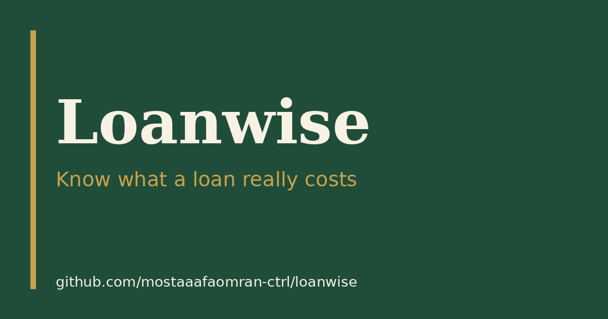

# Loanwise

Know what a loan really costs.

 

**Live demo:** https://mostaaafaomran-ctrl.github.io/loanwise/ (add `?demo=1` to see it filled with sample data)

Loan calculator with monthly payment, total interest, full schedule, flat vs reducing rate and extra payments.

## Features

- Monthly payment, total interest and total paid
- Full payment schedule, download as CSV
- Flat rate converted to the equal reducing-balance rate
- Extra monthly payment: see months and interest saved
- EGP, USD, SAR and EUR

## Run it locally

It is one `index.html` file. Open it in a browser. No build step, no dependencies, no server.

## Privacy

Everything runs in your browser. Nothing is uploaded. Data you enter is kept in your browser's local storage on your device only.

## بالعربي

حاسبة قروض: القسط الشهري، إجمالي الفايدة، جدول السداد كامل، والفرق بين الفايدة الثابتة والمتناقصة.

افتح الملف `index.html` في المتصفح وهيشتغل على طول، من غير تسجيل ومن غير سيرفر.

## License

MIT
